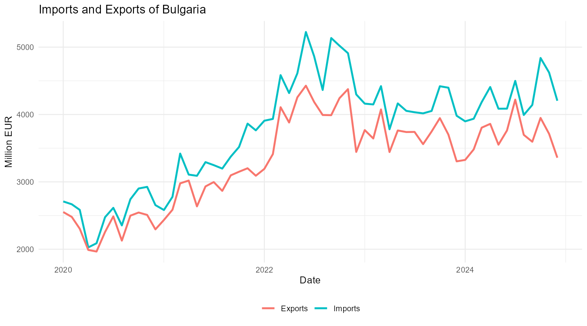

# Bulgarian Exports and Imports: a VECM Analysis

Do Bulgaria's exports and imports share a long-run equilibrium, and which side adjusts when they drift apart?
This project tests for cointegration between monthly exports and imports (2020–2024) and estimates a Vector Error Correction Model (VECM) using the Johansen approach.

Course project, Time Series Analysis – MSc Applied Mathematics (Mathematical Modelling in Economics), Sofia University.

---

## Key results

**Cointegration (Johansen, logs, restricted constant, seasonal dummies)**

| H0 | Trace | 5% c.v. | 1% c.v. | Max-eigenvalue | 5% c.v. | 1% c.v. |
|---|---|---|---|---|---|---|
| r = 0 | **28.54** | 19.96 | 24.60 | **25.91** | 15.67 | 20.20 |
| r ≤ 1 | 2.63 | 9.24 | 12.97 | 2.63 | 9.24 | 12.97 |

→ **One cointegrating relationship**, significant at the 1% level. Without seasonal dummies the evidence is borderline (trace = 18.49, between the 10% and 5% critical values), so modelling the monthly seasonality is essential.

**Long-run relationship**

$$\ln(\text{Exports}) = 0.93 \cdot \ln(\text{Imports}) + 0.49$$

A 1% increase in imports is associated with about a **0.93% increase in exports** in the long run – the two series move almost one-for-one.

**Adjustment to equilibrium (error-correction coefficients)**

| Equation | ECT coefficient | p-value |
|---|---|---|
| Δ ln(Exports) | **−0.69** | 0.080 |
| Δ ln(Imports) | +0.41 | 0.312 |

- **Exports do the adjusting:** when exports are above their long-run level relative to imports, they fall back towards equilibrium (significant at 10%).
- **Imports are weakly exogenous:** they do not respond to the disequilibrium.
- Short-run lagged differences are not significant in either equation; the seasonal dummies explain most of the short-run variation (R² = 0.58 and 0.54).



---

## Methodology

1. **Data** – monthly exports and imports of Bulgaria, million EUR, January 2020 – December 2024 (60 observations).
2. **Unit roots** – ADF, KPSS and Zivot–Andrews (allows for a structural break). Both series are I(1): e.g. ADF with trend τ = −1.77 (exports) and −1.93 (imports) in levels vs −7.42 and −8.17 in first differences (5% c.v. −3.45).
3. **Lag selection** – VARselect on the levels: SC and HQ choose 1 lag (AIC 11, FPE 4). K = 2 is used, the minimum for the Johansen procedure.
4. **Cointegration** – Johansen trace and maximum-eigenvalue tests, in levels and logs, with and without seasonal dummies and a 2022–2023 dummy (energy-price shock). The 2022–2023 dummy is unnecessary once seasonal dummies are included.
5. **Estimation** – VECM (transitory specification, restricted constant, monthly seasonal dummies), estimated with `cajorls`.
6. **Diagnostics** – Portmanteau test for serial correlation, Jarque–Bera normality test, ARCH-LM test.
7. **Dynamics** – impulse response functions (bootstrapped 95% intervals), forecast error variance decomposition and 12-month forecasts.

---

## Limitations

- Only 60 monthly observations, covering COVID-19 and the 2022 energy-price shock.
- The error-correction coefficient in the exports equation is significant only at the 10% level.
- The Johansen tests rely on asymptotic critical values, which can be imprecise in small samples.

---

## Repository structure

```
├── README.md
├── data/
│   └── Trade.csv                  # monthly exports and imports, million EUR, 2020–2024
├── code/
│   └── International_Trade_VECM.R
└── output/
    └── figures/
```

## How to run

1. Clone or download the repository and set the working directory to the repository folder.
2. Install the packages:

```r
install.packages(c("tidyverse", "zoo", "urca", "vars", "tsDyn", "lmtest"))
```

3. Run `code/International_Trade_VECM.R`.

## Data

Monthly exports and imports of goods of Bulgaria in million EUR, January 2020 – December 2024. Source: `[fill in: e.g. NSI or BNB]`.

## Author

Dimitar Zhelezov · [LinkedIn](https://www.linkedin.com/in/dimitarzhelezov) · [GitHub](https://github.com/dimiturzhelezov)
